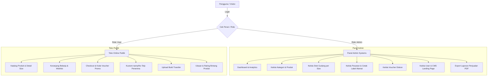

# 📄 LAPORAN DOKUMENTASI LENGKAP SISTEM E-COMMERCE SEPATU.ID

**Nama Aplikasi**: Sepatu.id  
**Versi Sistem**: 2.0 (Full Production Ready)  
**Status Database & Migrasi**: Aktif & Terverifikasi  
**Tanggal Laporan**: 1 September 2026  

---

## 1. 📌 Ringkasan Eksekutif

**Sepatu.id** adalah platform *e-commerce* toko online resmi berbasis web modern yang dirancang khusus untuk penjualan berbagai jenis koleksi sepatu (seperti *Running, Casual, Basketball, Lifestyle, dan Training*). 

Aplikasi ini menyediakan pengalaman belanja yang seamless bagi pelanggan mulai dari eksplorasi produk, kustomisasi varian ukuran (*size*), pengelolaan *wishlist* dan keranjang belanja, penerapan **voucher diskon promo**, fleksibilitas kustomisasi penerima paket, hingga pengunggahan bukti pembayaran transfer. 

Di sisi pengelola, aplikasi dilengkapi **Panel Admin Komprehensif** untuk manajemen stok gudang per ukuran, verifikasi pembayaran, pencetakan label alamat pengiriman (*shipping label*), pembuatan voucher promo, hingga ekspor laporan penjualan resmi berformat PDF.

---

## 2. 🛠️ Spesifikasi Teknologi (Tech Stack)

| Komponen | Teknologi / Library | Deskripsi Fungsi |
| :--- | :--- | :--- |
| **Framework Backend** | PHP 8.x / Laravel 11.x | Arsitektur MVC, Eloquent ORM, Authentication, Middleware, & Validation Rules |
| **Database Engine** | MySQL / MariaDB | Penyimpanan data relasional produk, varian ukuran, transaksi, voucher, & audit log |
| **Frontend UI** | HTML5, Blade Templating, TailwindCSS | Layout responsif, komponen modern, glassmorphism, & tema warna kustom |
| **Reaktivitas UI** | Alpine.js | Interaktivitas modal dialog, tab switcher, kalkulasi diskon realtime, & spinner loading |
| **Asset Bundler** | Vite | Kompilasi CSS & JavaScript dengan performa tinggi |
| **Export Engine** | DomPDF / Native HTML Print | Pencetakan laporan resmi PDF & label alamat pengiriman |

---

## 3. 👥 Hak Akses Pengguna & Keamanan (Multi-Role System)

Sistem menggunakan kontrol akses berbasis peran (RBAC) yang terbagi menjadi dua level:



---

## 4. 🛒 Modul & Fitur Publik (Customer Area)

### 4.1 Katalog & Detail Produk Sepatu
- **Filter & Pencarian**: Pencarian cepat berdasarkan nama sepatu, kategori (*Running, Casual, etc.*), serta pengurutan harga terendah/tertinggi.
- **Manajemen Varian Ukuran (Shoe Size)**: Pemilihan ukuran sepatu (*size 39–45*) dengan status ketersediaan stok realtime.
- **Sistem Rating & Ulasan**: Ulasan jujur dari pembeli yang telah menyelesaikan pesanan, dilengkapi skor rating bintang (1-5).

### 4.2 Keranjang Belanja & Wishlist
- **Wishlist Interaktif**: Pelanggan dapat menyukai produk sepatu favorit dengan tombol *toggle* ikon hati.
- **Keranjang Belanja (Cart)**: Mengubah kuantitas item, menghapus produk, dan menghitung estimasi subtotal secara otomatis.

### 4.3 Checkout & Kustomisasi Penerima
- **Flexibility Recipient**: Pelanggan dapat mengubah **Nama Penerima** dan **Nomor Telepon/WA Penerima** saat checkout tanpa merubah nama akun utama profil (cocok untuk pengiriman hadiah/kado).
- **Voucher Promo Diskon**: Field pengisian kode voucher promo (potongan persentase `%` atau nominal fixed `Rp`) yang memotong tagihan secara otomatis jika memenuhi syarat minimal belanja dan kuota.
- **Metode Pembayaran**: Mendukung **Transfer Bank (BCA / Mandiri)** dan **COD (Bayar di Tempat)**.

### 4.4 Riwayat Pesanan & Upload Bukti Transfer
- **Pelacakan Status**: Pelanggan dapat memantau status pesanan (*Pending, Diproses, Dikirim, Selesai*).
- **Unggah Bukti Transfer**: Pembeli dengan metode transfer bank dapat mengunggah foto bukti pembayaran langsung dari halaman pesanan.
- **Konfirmasi Penerimaan**: Pembeli dapat mengonfirmasi barang telah diterima untuk menyelesaikan transaksi.

---

## 5. ⚙️ Modul & Fitur Admin Panel (Store Management)

### 5.1 Dashboard Analytics & Log Aktivitas
- Ringkasan total pendapatan penjualan, jumlah pesanan, total pelanggan, serta indikator stok menipis.
- Audit Trail Log: Merekam seluruh riwayat aktivitas penting admin (membuat produk, mengubah status pesanan, dsb).

### 5.2 Kelola Kategori Sepatu ([admin/categories](file:///c:/laragon/www/Sepatu.id/resources/views/admin/categories/index.blade.php))
- Pengelompokan jenis sepatu.
- Fitur pencarian nama kategori, pagination, serta modal konfirmasi hapus interaktif dengan indikator *spinner loading state*.

### 5.3 Kelola Produk & Stok Gudang ([admin/stock](file:///c:/laragon/www/Sepatu.id/resources/views/admin/stock/index.blade.php))
- Penambahan produk baru dengan gambar, harga, deskripsi, dan varian ukuran.
- **Stok Gudang**: Manajemen penambahan/pengurangan stok per ukuran sepatu secara presisi.

### 5.4 Kelola Pesanan & Cetak Label Alamat ([admin/orders](file:///c:/laragon/www/Sepatu.id/resources/views/admin/orders/index.blade.php))
- **Verifikasi Pembayaran**: Admin dapat memeriksa foto bukti transfer dan mengubah status menjadi *Paid / Lunas*.
- **Update Status Pesanan**: Mengubah status dari *Pending → Diproses → Dikirim → Selesai*.
- **🖨️ Cetak Label Alamat Pengiriman (Shipping Label)**: Fitur cetak khusus siap print yang memuat informasi Pengirim (Sepatu.id Store), Penerima (Nama, Telp, Alamat Lengkap), Rincian Produk Sepatu yang diorder, dan Catatan Khusus Kurir.

### 5.5 Kelola Voucher Diskon ([admin/vouchers](file:///c:/laragon/www/Sepatu.id/resources/views/admin/vouchers/index.blade.php))
- Pembuat kode voucher promo custom.
- Pengaturan tipe persen `%` atau nominal fixed `Rp`, batas kuota pengguna, minimal belanja, serta tanggal kadaluarsa.
- Tombol *quick toggle* untuk mengaktifkan/menonaktifkan kupon secara instan.

### 5.6 Export Laporan Penjualan PDF
- Pencetakan laporan pendapatan dan rekap transaksi resmi berformat PDF untuk kebutuhan pembukuan toko.

---

## 6. 🗄️ Struktur Basis Data (Database Entity Overview)

| Tabel | Deskripsi & Field Utama |
| :--- | :--- |
| **`users`** | Data akun (`id`, `name`, `email`, `password`, `phone`, `role`, `address`) |
| **`categories`** | Data kategori (`id`, `name`, `created_at`) |
| **`products`** | Data sepatu (`id`, `category_id`, `name`, `slug`, `description`, `price`, `image`) |
| **`product_variants`** | Varian ukuran (`id`, `product_id`, `size`, `stock`) |
| **`vouchers`** | Kupon promo (`id`, `code`, `name`, `type`, `amount`, `min_spend`, `max_discount`, `usage_limit`, `used_count`, `is_active`, `starts_at`, `expires_at`) |
| **`orders`** | Transaksi (`id`, `user_id`, `voucher_id`, `voucher_code`, `recipient_name`, `recipient_phone`, `shipping_address`, `subtotal`, `discount_amount`, `total`, `status`, `payment_method`, `payment_status`, `payment_proof`, `notes`) |
| **`order_items`** | Detail isi item (`id`, `order_id`, `product_variant_id`, `quantity`, `price`) |
| **`reviews`** | Ulasan produk (`id`, `order_id`, `product_id`, `user_id`, `rating`, `comment`) |
| **`activity_logs`** | Log audit trail (`id`, `user_id`, `action`, `description`, `ip_address`) |

---

## 7. 🚀 Panduan Pengoperasian Tambahan & Maintenance

1. **Menjalankan Server Lokal**:
   ```bash
   php artisan serve
   ```
2. **Clear Cache & Optimized Compile**:
   ```bash
   php artisan config:clear
   php artisan route:clear
   php artisan view:clear
   ```
3. **Seeding Data Voucher / Produk Contoh**:
   ```bash
   php artisan db:seed --class=VoucherSeeder
   ```

---
*Laporan ini dibuat secara otomatis untuk memberikan gambaran arsitektur dan fungsionalitas penuh dari Sistem E-Commerce Sepatu.id.*
